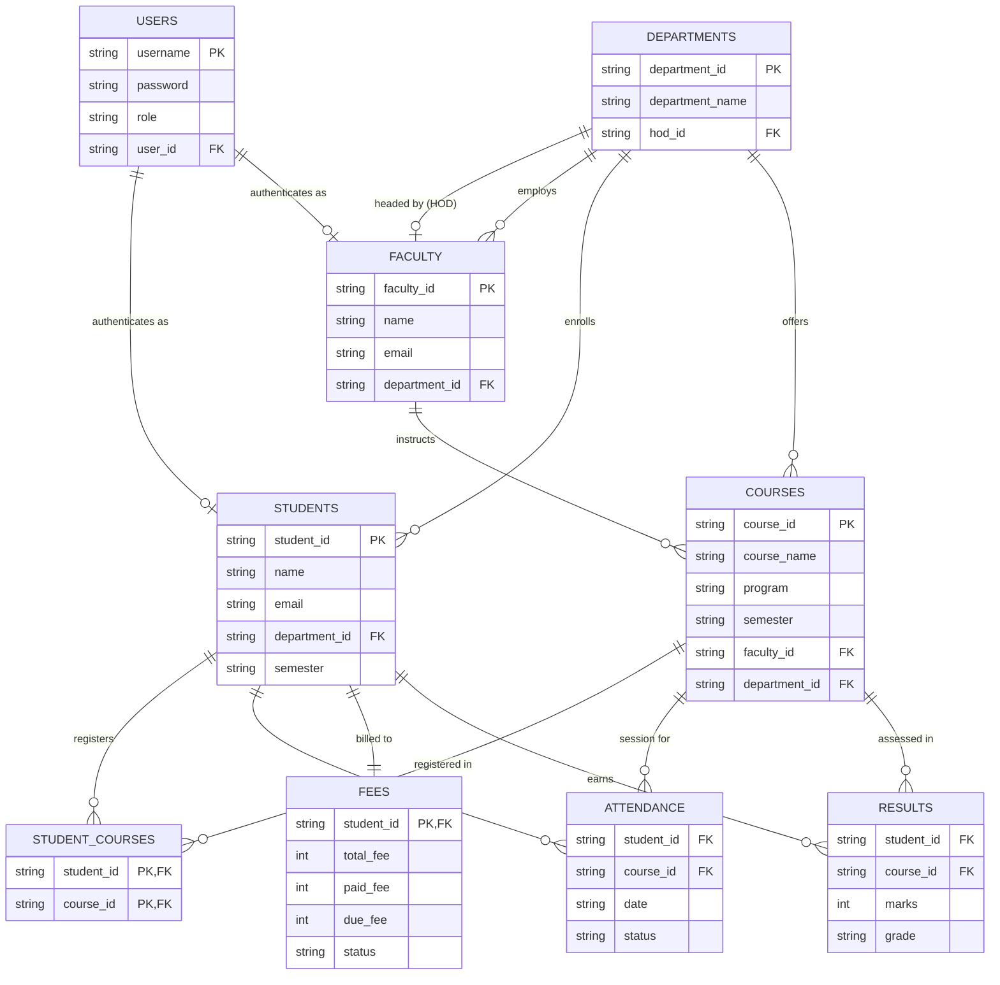

# University ERP Platform (PBL_OS) — Complete Architectural, Technical & Development Specification

> **Document Version:** 2.0.0  
> **Target Audience:** Software Engineers, System Architects, Operating System Students, and AI Language Models requiring full technical and contextual grounding of this codebase.  
> **Repository Root:** `c:\Users\sahil\Desktop\PBL_OS`  
> **Application Root:** `c:\Users\sahil\Desktop\PBL_OS\UniversityERP`  

---

## 1. Executive Summary & Project Context

### 1.1 Project Identity & Purpose
The **University ERP Platform** is a lightweight, educational web-based Enterprise Resource Planning (ERP) platform developed as a **Project-Based Learning (PBL)** assignment in **Operating Systems (PBL_OS)**. It bridges theoretical computer science concepts (Operating System internals, process management, memory allocation, and file system I/O) with practical, accessible software engineering (Flask web framework, MVC architecture, role-based access control, and file-based data persistence).

### 1.2 Core Architectural Philosophy
* **Zero External Heavyweight Dependencies:** The platform operates strictly on **Python 3** and **Flask (>= 3.0.0)**. It does not require database daemons (such as MySQL, PostgreSQL, MongoDB), caching layers (Redis), or cloud SDKs.
* **Flat-File Storage Engine:** All database operations (CRUD) utilize standard Comma-Separated Values (`.csv`) files managed directly by the Python standard library `csv` module and the host OS file system.
* **Pedagogical Transparency:** Every operation—from session handling to disk reads and process scheduling—is explicitly traceable to host OS behaviors, making it an ideal showcase for OS academic examinations, project vivas, and architectural demonstrations.

---

## 2. Technology Stack & Specifications

| Layer | Technology | Specification / Version | Rationale & Implementation Details |
| :--- | :--- | :--- | :--- |
| **Runtime Environment** | Python | `>= 3.7` (tested on Python 3.10+) | Standard cross-platform interpreter handling process lifecycle and native CPython memory models. |
| **Web Framework** | Flask | `>= 3.0.0` (WSGI compliant) | Lightweight microframework routing HTTP requests, serving Jinja2 templates, and managing signed client cookies. |
| **Persistence / Storage** | Flat CSV Files | Python native `csv.DictReader` / `csv.DictWriter` | File-system-level persistent storage residing in the `data/` directory. Zero DB installation required. |
| **Frontend Templates** | Jinja2 | Bundled with Flask 3.x | Server-Side Rendering (SSR) generating dynamic HTML with loops, conditionals, and layout variables. |
| **Styling (CSS)** | Vanilla CSS3 | Custom CSS (`static/style.css`) | Custom design system using flexbox, CSS grid, CSS variables, and clean enterprise dashboard styling. |
| **Client Scripting (JS)** | Vanilla JavaScript | ES6+ (`static/script.js`) | Lightweight DOM operations, auto-dismissing flash alerts, real-time fee recalculation, search filters, and confirmation dialogs. |
| **Deployment / Server** | Flask Development Server | WSGI Local (`0.0.0.0:5000`) | Single-threaded synchronous process listening on all local interfaces with `debug=True`. |

---

## 3. Directory & File Manifest

```
PBL_OS/
├── package-lock.json             # Root NPM lockfile artifact (legacy placeholder)
├── arc.md                        # Master Architecture & Technical Specification
└── UniversityERP/
    ├── app.py                    # Core Flask application, route definitions, auth & business logic (1019 lines)
    ├── requirements.txt          # Python dependencies (flask>=3.0.0)
    ├── README.md                 # Primary project documentation and manual testing logs
    ├── arc.md                    # In-tree Architecture & Technical Specification (This File)
    ├── find_faculty.py           # Utility: Codebase scanner for legacy faculty key usages
    ├── fix_faculty.py            # Utility: Migration patch for course faculty_id reference
    ├── update_app.py             # Utility: Migration patch for program/course naming alignment
    ├── update_sidebar.py         # Utility: Batch template updater injecting navigation links
    ├── data/                     # Data persistence layer (9 CSV files)
    │   ├── users.csv             # User credentials, roles, and entity bindings
    │   ├── students.csv          # Student demographic and departmental records
    │   ├── faculty.csv           # Faculty directory and department associations
    │   ├── departments.csv       # Academic departments and HOD bindings
    │   ├── courses.csv           # Course catalog, faculty allocations, and departments
    │   ├── student_courses.csv   # Many-to-Many student enrollment mapping table
    │   ├── attendance.csv        # Student attendance records (Present / Absent)
    │   ├── fees.csv              # Fee accounting records (total, paid, due, status)
    │   └── results.csv           # Examination marks, grades, and course associations
    ├── static/                   # Static web assets
    │   ├── style.css             # Unified application styles and theme variables
    │   └── script.js             # Client-side UI interactions and utility functions
    └── templates/                # 36 Jinja2 HTML templates
        ├── login.html            # Universal authentication entry point
        │
        ├── admin_dashboard.html  # System statistics and primary administration hub
        ├── students.html         # Admin student management directory
        ├── add_student.html      # New student onboarding form
        ├── edit_student.html     # Student record modification form
        ├── faculty.html          # Admin faculty management directory
        ├── add_faculty.html      # New faculty onboarding form
        ├── edit_faculty.html     # Faculty record modification form
        ├── departments.html      # Department registry and HOD assignment
        ├── add_department.html   # Department registration form
        ├── edit_department.html  # Department modification form
        ├── courses.html          # Course catalogue and faculty allocation list
        ├── add_course.html       # Course creation form
        ├── edit_course.html      # Course modification form
        ├── student_courses_admin.html # Many-to-many enrollment directory
        ├── add_student_course.html    # Student course enrollment form
        ├── attendance.html       # Global attendance query & filter report
        ├── add_attendance.html   # Manual attendance entry form
        ├── edit_attendance.html  # Attendance status correction form
        ├── fees.html             # Institutional fee ledger
        ├── update_fees.html      # Fee payment and status recording form
        ├── results.html          # Academic result ledger
        ├── add_result.html       # Manual grade and marks entry form
        │
        ├── faculty_dashboard.html # Faculty home: assigned courses list
        ├── faculty_attendance.html# Class-wide bulk attendance entry interface
        ├── faculty_marks.html     # Class-wide bulk marks entry interface
        │
        ├── hod_dashboard.html    # Department Head statistics and overview
        ├── hod_faculty.html      # Departmental faculty roster
        ├── hod_students.html     # Departmental student roster
        ├── hod_courses.html      # Departmental course offerings
        │
        ├── student_dashboard.html # Student portal landing page
        ├── student_profile.html   # Student personal and academic identity
        ├── student_attendance.html# Student attendance report & percentage summary
        ├── student_courses.html   # Student enrolled course curriculum list
        ├── student_fees.html      # Student individual fee and due statements
        └── student_results.html   # Student semester grade card and marks sheet
```

---

## 4. System Architecture & Design Patterns

### 4.1 Model-View-Controller (MVC) Mapping in Flask

```
               ┌────────────────────────────────────────────────────────┐
               │                     WEB BROWSER                        │
               │  (HTML5 + Vanilla CSS3 + Client-Side JavaScript ES6)   │
               └───────────────────▲─────────────────┬──────────────────┘
                                   │ HTTP Response   │ HTTP Request
                                   │ (HTML / 200 OK) │ (GET / POST)
               ┌───────────────────┴─────────────────▼──────────────────┐
               │            FLASK APPLICATION CONTROLLER (`app.py`)     │
               │  - WSGI Routing Engine (`@app.route`)                  │
               │  - Session & Role Guard Validation                     │
               │  - Business Logic & ID Generation (`get_next_id`)      │
               │  - Form Parsing, Validation, and Flash Messaging       │
               └───────────────┬─────────────────────────▲──────────────┘
                               │                         │
            Invokes Render     │                         │ Ingests Dictionary
            With Context Dict  │                         │ Data Structures
                               ▼                         │
               ┌───────────────────────────┐ ┌───────────┴──────────────┐
               │        VIEW LAYER         │ │       MODEL LAYER        │
               │  (Jinja2 Templates / HTML)│ │  (`read_csv`, `write_csv`│
               │  36 HTML Files            │ │   `append_csv` helpers)  │
               └───────────────────────────┘ └───────────┬──────────────┘
                                                         │
                                        Disk I/O Streams │ (open, read, write)
                                                         ▼
                                           ┌───────────────────────────┐
                                           │  PERSISTENCE STORAGE      │
                                           │  (`data/*.csv` Files)     │
                                           └───────────────────────────┘
```

1. **Model Layer (`data/*.csv` & Helper Functions in `app.py`):**
   * Data is stored entirely in flat files (`.csv`).
   * No active ORM is utilized; data objects are native Python `list[dict]` instances generated via `csv.DictReader` and serialized using `csv.DictWriter`.
   * Standardized helpers: `read_csv(filename)`, `write_csv(filename, data, fieldnames)`, `append_csv(filename, row, fieldnames)`.
2. **Controller Layer (`app.py`):**
   * Acts as the central traffic controller with 44 route endpoints.
   * Manages request validation, route guards based on `session['role']`, transactional file mutations, and automatic user credential provisioning.
3. **View Layer (`templates/*.html` + `static/`):**
   * 36 Jinja2 templates using template inheritance and server-side interpolation.
   * Rendered HTML pages contain dynamic feedback (flash banners) and sidebar navigation customized per role.

---

## 5. Database Schema & Data Models Specification

All files are stored under `UniversityERP/data/` with UTF-8 encoding.

### 5.1 `users.csv` (Authentication & RBAC)
* **Purpose:** Stores credentials and binds credentials to specific system entities.
* **Fields:** `username,password,role,user_id`
* **Field Specifications:**
  * `username` (String, Unique Primary Key): Login identity (e.g., `admin`, `sharma`, `rahul`, `sharma_hod`).
  * `password` (String): Stored in plain text (e.g., `admin123`, `1234`).
  * `role` (Enum String): Permitted values: `Admin`, `Faculty`, `Student`, `HOD`.
  * `user_id` (String, Foreign Reference): Points to `student_id` (`STxxx`), `faculty_id` (`Fxxx`), or Admin Identifier (`A001`).

### 5.2 `departments.csv` (Academic Departments)
* **Purpose:** Stores department divisions and their assigned Head of Department (HOD).
* **Fields:** `department_id,department_name,hod_id`
* **Field Specifications:**
  * `department_id` (String, PK, Prefix `D`): e.g., `D001`, `D002`.
  * `department_name` (String): e.g., `Artificial Intelligence`, `Computer Science Engineering`.
  * `hod_id` (String, FK -> `faculty.faculty_id`): Identifies the faculty member designated as HOD.

### 5.3 `students.csv` (Student Registry)
* **Purpose:** Demographic and academic enrollment profile of students.
* **Fields:** `student_id,name,email,department_id,semester`
* **Field Specifications:**
  * `student_id` (String, PK, Prefix `ST`): e.g., `ST001`, `ST002`.
  * `name` (String): Full student name.
  * `email` (String, Unique): e.g., `rahul@gmail.com`.
  * `department_id` (String, FK -> `departments.department_id`): e.g., `D001`.
  * `semester` (Integer / String): Current semester (e.g., `3`, `4`).

### 5.4 `faculty.csv` (Faculty Registry)
* **Purpose:** Directory of academic instructors and professors.
* **Fields:** `faculty_id,name,email,department_id`
* **Field Specifications:**
  * `faculty_id` (String, PK, Prefix `F`): e.g., `F001`, `F002`.
  * `name` (String): Full instructor name (e.g., `Dr. Sharma`).
  * `email` (String, Unique): e.g., `sharma@gmail.com`.
  * `department_id` (String, FK -> `departments.department_id`): Department allocation (e.g., `D001`).

### 5.5 `courses.csv` (Course Catalogue & Faculty Allocation)
* **Purpose:** Academic courses, semester placement, and instructor assignments.
* **Fields:** `course_id,course_name,program,semester,faculty_id,department_id`
* **Field Specifications:**
  * `course_id` (String, PK, Prefix `C`): e.g., `C001`, `C002`.
  * `course_name` (String): Course title (e.g., `Operating Systems`, `Machine Learning`).
  * `program` (String): Program title or department code (e.g., `D001` or `AI`).
  * `semester` (Integer / String): Semester number in which course is taught.
  * `faculty_id` (String, FK -> `faculty.faculty_id`): Assigned instructor.
  * `department_id` (String, FK -> `departments.department_id`): Department owning the curriculum.

### 5.6 `student_courses.csv` (M:N Course Enrollment Junction)
* **Purpose:** Junction table resolving the Many-to-Many relationship between students and courses.
* **Fields:** `student_id,course_id`
* **Field Specifications:**
  * `student_id` (String, FK -> `students.student_id`): Enrolled student.
  * `course_id` (String, FK -> `courses.course_id`): Target course.
  * *Composite Key:* `(student_id, course_id)` is enforced unique by `app.py`.

### 5.7 `attendance.csv` (Class Attendance Records)
* **Purpose:** Daily session attendance ledger.
* **Fields:** `student_id,course_id,date,status`
* **Field Specifications:**
  * `student_id` (String, FK -> `students.student_id`)
  * `course_id` (String, FK -> `courses.course_id`)
  * `date` (Date String): `YYYY-MM-DD` (e.g., `2026-10-08`).
  * `status` (Enum String): `Present` or `Absent`.
  * *Constraint:* Unique per `(student_id, course_id, date)`.

### 5.8 `fees.csv` (Student Financial Accounts)
* **Purpose:** Institutional fee records and payment tracking.
* **Fields:** `student_id,total_fee,paid_fee,due_fee,status`
* **Field Specifications:**
  * `student_id` (String, PK / FK -> `students.student_id`)
  * `total_fee` (Numeric String): Total tuition charges (e.g., `100000`).
  * `paid_fee` (Numeric String): Amount paid to date.
  * `due_fee` (Numeric String): Computed as `total_fee - paid_fee`.
  * `status` (Enum String): `Paid` (if `due_fee == 0`) or `Pending` (if `due_fee > 0`).

### 5.9 `results.csv` (Academic Grading Ledger)
* **Purpose:** Exam score recording and grade translation.
* **Fields:** `student_id,course_id,marks,grade`
* **Field Specifications:**
  * `student_id` (String, FK -> `students.student_id`)
  * `course_id` (String, FK -> `courses.course_id`)
  * `marks` (Integer String): Scale 0–100.
  * `grade` (String): Auto-calculated letter grade (`A+`, `A`, `B+`, `B`, `C`, `F`).

---

## 6. Entity Relationship Diagram (ERD)



---

## 7. Role-Based Access Control (RBAC) & Authorization

The system implements strict four-tier RBAC enforced at the top of every Flask route controller via session interrogation:

```python
if session.get('role') != '<RequiredRole>':
    return redirect(url_for('login'))
```

### 7.1 Role Privilege Matrix

| Feature / Action | Admin | Faculty | HOD | Student |
| :--- | :---: | :---: | :---: | :---: |
| **Login / Logout** | Yes | Yes | Yes | Yes |
| **System Statistics Dashboard** | Yes (Global) | Yes (Assigned) | Yes (Department) | Yes (Personal) |
| **Student Management (CRUD)** | Full CRUD | No | Read-Only (Dept) | Read-Only (Self Profile) |
| **Faculty Management (CRUD)** | Full CRUD | No | Read-Only (Dept) | No |
| **Department Management (CRUD)**| Full CRUD | No | Read-Only (Own Dept) | No |
| **Course Creation & Assignment**| Full CRUD | No | Read-Only (Dept) | No |
| **Student Course Enrollment** | Full CRUD | No | No | Read-Only (Enrolled) |
| **Attendance Operations** | Full (View/Add/Edit/Delete)| Mark for assigned courses | No | Read-Only (Personal + %) |
| **Fee Ledger Operations** | View & Update | No | No | Read-Only (Personal Balance) |
| **Results & Grade Entry** | View & Add | Enter for assigned courses | No | Read-Only (Personal Marks) |

### 7.2 Default Demo Credentials

| Role | Username | Password | User ID | Bound Name / Designation |
| :--- | :--- | :--- | :--- | :--- |
| **Admin** | `admin` | `admin123` | `A001` | System Administrator |
| **HOD (AI)** | `sharma_hod` | `1234` | `F001` | Dr. Sharma (Head, Artificial Intelligence) |
| **HOD (CSE)**| `kumar_hod` | `1234` | `F002` | Mr. Kumar (Head, Computer Science Eng.) |
| **Faculty** | `sharma` | `1234` | `F001` | Dr. Sharma (AI Department) |
| **Faculty** | `kumar` | `1234` | `F002` | Mr. Kumar (CSE Department) |
| **Faculty** | `singh` | `1234` | `F003` | Dr. Singh (AI Department) |
| **Faculty** | `patel` | `1234` | `F004` | Ms. Patel (CSE Department) |
| **Student** | `rahul` | `1234` | `ST001` | Rahul (AI, Semester 3) |
| **Student** | `aman` | `1234` | `ST002` | Aman (CSE, Semester 3) |
| **Student** | `priya` | `1234` | `ST003` | Priya (AI, Semester 3) |
| **Student** | `neha` | `1234` | `ST004` | Neha (CSE, Semester 3) |

---

## 8. Complete Route & Controller API Specification

The application defines 44 distinct routes in `app.py`.

### 8.1 Core & Authentication Endpoints

| Route Path | HTTP Methods | Handler Function | Role Auth | Description & Data Handling |
| :--- | :---: | :--- | :---: | :--- |
| `/` | `GET` | `index()` | Public | Root redirector; directs client directly to `/login`. |
| `/login` | `GET`, `POST` | `login()` | Public | Ingests `username`, `password`. Scans `users.csv`. Sets `session['username']`, `session['role']`, `session['user_id']`. Dispatches to corresponding role dashboard. |
| `/logout` | `GET` | `logout()` | Any Active | Invokes `session.clear()` and redirects to `/login`. |

### 8.2 Admin Module Endpoints

| Route Path | HTTP Methods | Handler Function | Role Auth | Description & Data Handling |
| :--- | :---: | :--- | :---: | :--- |
| `/admin` | `GET` | `admin_dashboard()` | Admin | Reads metrics (`get_student_count`, `get_faculty_count`, `get_course_count`) and renders `admin_dashboard.html`. |
| `/admin/students` | `GET` | `admin_students()` | Admin | Lists all student records joined with departmental metadata. |
| `/admin/students/add` | `GET`, `POST` | `add_student()` | Admin | Generates next `STxxx` ID. Appends to `students.csv`. Automatically creates matching login account in `users.csv` with default password `1234`. |
| `/admin/students/edit/<id>` | `GET`, `POST` | `edit_student()` | Admin | Retrieves student by `student_id`, updates demographic data, and rewrites `students.csv`. |
| `/admin/students/delete/<id>`| `GET` | `delete_student()` | Admin | Filters out record matching `student_id` and writes back `students.csv`. |
| `/admin/faculty` | `GET` | `admin_faculty()` | Admin | Lists all faculty members and assigned departments. |
| `/admin/faculty/add` | `GET`, `POST` | `add_faculty()` | Admin | Generates `Fxxx` ID, appends to `faculty.csv`, and automatically creates `users.csv` login credentials. |
| `/admin/faculty/edit/<id>` | `GET`, `POST` | `edit_faculty()` | Admin | Modifies faculty details and department association. |
| `/admin/faculty/delete/<id>` | `GET` | `delete_faculty()` | Admin | Removes faculty member from `faculty.csv`. |
| `/admin/courses` | `GET` | `admin_courses()` | Admin | Lists courses joined with instructor and department names. |
| `/admin/courses/add` | `GET`, `POST` | `add_course()` | Admin | Generates `Cxxx` ID and stores course allocation in `courses.csv`. |
| `/admin/courses/edit/<id>` | `GET`, `POST` | `edit_course()` | Admin | Updates course title, semester, or faculty assignment. |
| `/admin/courses/delete/<id>` | `GET` | `delete_course()` | Admin | Deletes course record from `courses.csv`. |
| `/admin/student-courses` | `GET` | `admin_student_courses()` | Admin | Displays Many-to-Many student enrollment mapping table. |
| `/admin/student-courses/add`| `GET`, `POST` | `admin_add_student_course()` | Admin | Validates and appends `student_id` + `course_id` to `student_courses.csv` with duplicate prevention. |
| `/admin/student-courses/delete/<s_id>/<c_id>` | `GET` | `admin_delete_student_course()` | Admin | Removes specific course enrollment link. |
| `/admin/attendance` | `GET` | `admin_attendance()` | Admin | Multi-filter attendance report filtering by `student_id`, `course_id`, and `date`. |
| `/admin/attendance/add` | `GET`, `POST` | `add_attendance()` | Admin | Adds attendance with validation against `students.csv`, `courses.csv`, and duplicate date check. |
| `/admin/attendance/edit/<s_id>/<c_id>/<date>` | `GET`, `POST` | `edit_attendance()` | Admin | Updates attendance state (`Present` / `Absent`). |
| `/admin/attendance/delete/<s_id>/<c_id>/<date>`| `GET` | `delete_attendance()` | Admin | Removes attendance entry. |
| `/admin/fees` | `GET` | `admin_fees()` | Admin | Displays student fee accounts, paid amounts, and arrears. |
| `/admin/fees/update/<id>` | `GET`, `POST` | `update_fees()` | Admin | Recomputes `due_fee = total_fee - paid_fee` and sets `status = Paid/Pending`. |
| `/admin/results` | `GET` | `admin_results()` | Admin | Displays examination grades and marks ledger. |
| `/admin/results/add` | `GET`, `POST` | `add_result()` | Admin | Converts numeric marks to letter grade and persists to `results.csv`. |
| `/admin/departments` | `GET` | `admin_departments()` | Admin | Lists departments and assigned HODs. |
| `/admin/departments/add` | `GET`, `POST` | `admin_add_department()` | Admin | Generates `Dxxx` ID and creates department record. |
| `/admin/departments/edit/<id>` | `GET`, `POST` | `admin_edit_department()` | Admin | Modifies department name or designated HOD ID. |
| `/admin/departments/delete/<id>`| `GET` | `admin_delete_department()` | Admin | Deletes department from `departments.csv`. |

### 8.3 Faculty Module Endpoints

| Route Path | HTTP Methods | Handler Function | Role Auth | Description & Data Handling |
| :--- | :---: | :--- | :---: | :--- |
| `/faculty` | `GET` | `faculty_dashboard()` | Faculty | Resolves faculty session identity (`user_id`) and displays assigned courses. |
| `/faculty/attendance/<c_id>`| `GET`, `POST` | `faculty_attendance()` | Faculty | **Security Check:** Asserts `course['faculty_id'] == session['user_id']`. Ingests bulk class attendance for all enrolled students on specified date. Updates existing records or appends new ones. |
| `/faculty/marks/<c_id>` | `GET`, `POST` | `faculty_marks()` | Faculty | **Security Check:** Asserts course assignment. Ingests bulk numerical marks for enrolled students, executes grade translation, and writes to `results.csv`. |

### 8.4 Head of Department (HOD) Module Endpoints

| Route Path | HTTP Methods | Handler Function | Role Auth | Description & Data Handling |
| :--- | :---: | :--- | :---: | :--- |
| `/hod` | `GET` | `hod_dashboard()` | HOD | Resolves HOD's department via `departments.csv` where `hod_id == session['user_id']`. Computes totals for department faculty, students, and courses. |
| `/hod/faculty` | `GET` | `hod_faculty()` | HOD | Displays faculty members belonging strictly to the HOD's department (`f['department_id'] == dept['department_id']`). |
| `/hod/students` | `GET` | `hod_students()` | HOD | Displays student roster enrolled in the HOD's department. |
| `/hod/courses` | `GET` | `hod_courses()` | HOD | Displays courses offered under the HOD's academic department. |

### 8.5 Student Module Endpoints

| Route Path | HTTP Methods | Handler Function | Role Auth | Description & Data Handling |
| :--- | :---: | :--- | :---: | :--- |
| `/student` | `GET` | `student_dashboard()` | Student | Student home landing page with personal greeting and quick-nav links. |
| `/student/profile` | `GET` | `student_profile()` | Student | Read-only view of student's registration, email, department, and semester. |
| `/student/attendance` | `GET` | `student_attendance()` | Student | Pulls attendance history for student's enrolled courses; renders table and course-by-course percentage summary. |
| `/student/courses` | `GET` | `student_courses()` | Student | Lists courses the student is explicitly registered in via `student_courses.csv`, along with assigned faculty. |
| `/student/fees` | `GET` | `student_fees()` | Student | Displays student's individual tuition fees, amount paid, outstanding due, and status. |
| `/student/results` | `GET` | `student_results()` | Student | Displays published marks and grades earned across enrolled subjects. |

---

## 9. Core Algorithms & Business Logic

### 9.1 Sequential Formatted ID Generator (`get_next_id`)
To prevent ID collisions without auto-incrementing SQL sequences:
```python
def get_next_id(prefix, filename, id_field):
    data = read_csv(filename)
    max_num = 0
    for row in data:
        if row[id_field].startswith(prefix):
            try:
                num = int(row[id_field][len(prefix):])
                if num > max_num:
                    max_num = num
            except ValueError:
                pass
    return f"{prefix}{max_num + 1:03d}"
```
* **Execution Complexity:** $O(N)$ where $N$ is the number of rows in the CSV.
* **Formatting:** Zero-padded 3-digit integer suffix (e.g., prefix `ST` -> `ST001`, `ST002`, `ST007`).

### 9.2 Academic Grading Algorithm
Calculated deterministically in `add_result` and `faculty_marks`:
$$\text{Grade}(\text{marks}) = \begin{cases} 
\text{A+} & \text{if } \text{marks} \ge 90 \\
\text{A}  & \text{if } 80 \le \text{marks} < 90 \\
\text{B+} & \text{if } 70 \le \text{marks} < 80 \\
\text{B}  & \text{if } 60 \le \text{marks} < 70 \\
\text{C}  & \text{if } 50 \le \text{marks} < 60 \\
\text{F}  & \text{if } \text{marks} < 50 
\end{cases}$$

### 9.3 Financial Accounting & Ledger Balancing
```python
paid_fee = int(request.form['paid_fee'])
due_fee = int(fee_record['total_fee']) - paid_fee
status = 'Paid' if due_fee == 0 else 'Pending'
```
* Enforces consistency between the total balance, paid balance, and clearance status.

### 9.4 Attendance Percentage Computation
Computed on client/template layers:
$$\text{Attendance \%} = \left( \frac{\text{Sessions Marked Present}}{\text{Total Sessions Recorded}} \right) \times 100$$

---

## 10. Operating System Concepts Deep-Dive (PBL_OS)

Because this repository was created specifically for **Project-Based Learning in Operating Systems**, its design deliberately reflects fundamental OS concepts:

### 10.1 Process Management & Lifecycle
* **Process Creation:** When the command `python app.py` executes, the host OS kernel's system loader allocates a **Process Control Block (PCB)**, assigns a unique **Process ID (PID)**, maps memory regions, and initiates execution at `app.py:1018`.
* **Single-Process Model:** The Flask development server executes as a single synchronous process. Requests are serviced sequentially within this process.
* **Process Context:** The process inherits environment variables, standard I/O file descriptors (`stdin=0`, `stdout=1`, `stderr=2`), and current working directory state (`os.path.dirname(os.path.abspath(__file__))`).

### 10.2 Memory Management & Data Structures
* **Process Virtual Address Space:** The OS kernel maps virtual address pages to physical RAM frames partitioned into:
  1. *Text / Code Segment:* Read-only bytecodes of Python and Flask.
  2. *Data / BSS Segment:* Global module references (e.g., `app`, `DATA_DIR`).
  3. *Heap Segment:* Python memory allocator (PyMalloc) dynamically storing parsed CSV records (`list[dict]`), session dictionaries, and cached template ASTs.
  4. *Call Stack Segment:* Tracks active function execution frames (`login()`, `read_csv()`, `write_csv()`).
* **Session Storage in Client Memory:** Sessions are cryptographically signed using `app.secret_key` and stored in client browser cookie memory, alleviating server RAM overhead.

### 10.3 File Management & Storage Subsystem
* **Virtual File System (VFS) Abstraction:** Python file operations interact with the host OS VFS layer (NTFS on Windows, ext4 on Linux).
* **System Call Sequence for File I/O:**
  ```
  read_csv() -> Python open() -> OS Syscall sys_open() -> File Handle Allocated
             -> Python read() -> OS Syscall sys_read() -> Disk Block / Buffer Read
             -> Python close()-> OS Syscall sys_close() -> File Handle Released
  ```
* **Read-Modify-Write Persistence Model:** To update a record in CSV, the application reads the complete file into memory, modifies the target dictionary, and writes the entire collection back out. This guarantees structural consistency of the CSV header and rows at the application level.

### 10.4 CPU Scheduling & State Transitions
* During execution, the Flask process transitions across classic OS process states:
  * **READY:** Waiting in the OS scheduler queue for CPU time.
  * **RUNNING:** Executing Python bytecode on the CPU core.
  * **BLOCKED / WAITING:** Suspended while awaiting network socket I/O (incoming HTTP request) or disk file I/O (`read_csv` / `write_csv`). The OS context-switches CPU execution to other system tasks during this window.

### 10.5 Protection Rings & File Access Permissions
* The application runs strictly in **User Space (Ring 3)**. Any disk read, disk write, or network port binding (`5000`) requires a trap/transition to **Kernel Space (Ring 0)** via OS system calls.
* File security adheres to the host OS Discretionary Access Control (DAC) or Windows Access Control Lists (ACLs) associated with the executing user account.

---

## 11. Frontend Architecture & Client-Side Logic

### 11.1 Styling System (`static/style.css`)
* **Color Palette:**
  * Primary Accent: Deep Blue (`#2c3e50`)
  * Secondary / Hover: Slate Blue (`#34495e`, `#3498db`)
  * Success / Present: Mint Green (`#2ecc71`, `#e8f8f5`)
  * Warning / Pending: Amber / Orange (`#f39c12`, `#fdf2e9`)
  * Danger / Absent / Delete: Coral Red (`#e74c3c`)
  * Neutral Background: Soft Gray (`#f4f6f9`)
* **Layout Grid:** CSS Grid (`stats-grid`) for responsive metric tiles; Flexbox for dashboard headers, sidebars, and control toolbars.
* **Components:** `.data-table`, `.card`, `.btn-primary`, `.btn-edit`, `.btn-delete`, `.alert`, `.stat-card`.

### 11.2 JavaScript Behaviors (`static/script.js`)
* **Flash Message Auto-Dismiss:** Queries all `.alert` containers and automatically applies opacity fade-out after 5,000ms followed by DOM node removal.
* **Destructive Action Confirmation:** Intercepts clicks on `.btn-delete` and prompts a native `window.confirm()` before allowing HTTP navigation.
* **Real-Time Client-Side Fee Recalculation:** Binds `input` listener on `paid_fee` field; computes `due = total_fee - paid_fee` and dynamically alters `status` select box to `Paid` or `Pending` without page reloads.
* **Marks Input Clamping:** Enforces strict numerical bounds (0 to 100) on `marks-input` fields during the `blur` event.
* **Dynamic Table Search Filter:** Generic client-side filtering via `data-search` attribute, dynamically hiding `<tr>` elements whose text does not match query.
* **Active Sidebar Link Highlighting:** Inspects `window.location.pathname` and dynamically applies active background styling to matching sidebar links.

---

## 12. Maintenance, Migration & Utility Scripts

In addition to `app.py`, the repository contains four operational utility scripts located in `UniversityERP/`:

1. **`find_faculty.py`**:
   * Scans `app.py` line-by-line looking for legacy dictionary key usages of `course['faculty']`.
2. **`fix_faculty.py`**:
   * Performs an automated in-place string replacement across `app.py`, migrating legacy `course['faculty']` references to `course['faculty_id']`.
3. **`update_app.py`**:
   * Performs in-place replacement aligning student program key references (`s['course']` -> `s['program']`).
4. **`update_sidebar.py`**:
   * Uses `glob` across `templates/*.html` to inject the "Student Course Enrollment" (`admin_student_courses`) sidebar link into all admin management templates.

---

## 13. Installation, Configuration & Execution Guide

### 13.1 Prerequisites
* Python 3.7 or higher installed on the host system.
* Windows, macOS, or Linux operating system.

### 13.2 Installation Steps
```bash
# 1. Clone or navigate to the repository
cd c:\Users\sahil\Desktop\PBL_OS\UniversityERP

# 2. (Optional but recommended) Create and activate a virtual environment
python -m venv venv
# On Windows:
venv\Scripts\activate
# On Linux/macOS:
source venv/bin/activate

# 3. Install required packages
pip install -r requirements.txt
# (Equivalent to: pip install flask)
```

### 13.3 Launching the Application
```bash
python app.py
```
* Output confirmation:
  ```
   * Serving Flask app 'app'
   * Debug mode: on
   * Running on all addresses (0.0.0.0)
   * Running on http://127.0.0.1:5000
   * Running on http://<your-local-ip>:5000
  ```
* Open your browser and navigate to: `http://127.0.0.1:5000`

---

## 14. Testing & Validation

### 14.1 Manual Verification Checklist

#### Admin Suite
- [x] Login with `admin` / `admin123`.
- [x] Verify metric cards on `/admin` match actual row counts in CSVs.
- [x] Add new student -> Check record in `students.csv` and auto-created user in `users.csv`.
- [x] Add new faculty -> Check record in `faculty.csv` and auto-created user in `users.csv`.
- [x] Add new department and assign HOD.
- [x] Enroll student in course via `/admin/student-courses/add`.
- [x] Filter attendance records by Student, Course, and Date.
- [x] Update fee payment and confirm status transition from `Pending` to `Paid`.

#### Faculty Suite
- [x] Login as `sharma` / `1234`.
- [x] Verify assigned courses on `/faculty`.
- [x] Mark class attendance on `/faculty/attendance/C001`.
- [x] Enter exam marks on `/faculty/marks/C001` -> Verify grade computation in `results.csv`.

#### HOD Suite
- [x] Login as `sharma_hod` / `1234`.
- [x] Verify department dashboard lists only Artificial Intelligence faculty and students.
- [x] Inspect `/hod/faculty`, `/hod/students`, and `/hod/courses`.

#### Student Suite
- [x] Login as `rahul` / `1234`.
- [x] View `/student/profile`.
- [x] Inspect `/student/attendance` and verify percentage calculations.
- [x] Inspect `/student/courses`, `/student/fees`, and `/student/results`.

---

## 15. Security, Concurrency & Architectural Limitations

As a student PBL project, the current design consciously accepts certain trade-offs:

1. **Plain-Text Credentials:** Passwords in `users.csv` are unhashed. Production systems require cryptographic hashing (e.g., Argon2, bcrypt) and salt generation.
2. **File-Level Race Conditions:** `write_csv` overwrites the entire file without operating-system-level file locks (`fcntl.flock` on Unix or `LockFileEx` on Windows). Concurrent requests mutating the same CSV could overwrite each other.
3. **Absence of CSRF Tokens:** HTML forms do not include anti-CSRF tokens (`Flask-WTF`).
4. **CSV Scalability:** Search and filtering operations perform linear scans ($O(N)$). Lacks indexing and B-tree optimisations provided by relational database engines.
5. **Session Secret Key Hardcoded:** `app.secret_key = 'university_erp_secret_key'` is hardcoded rather than injected via environment variables.

---

## 16. Future Roadmap & Production Hardening

1. **Storage Layer Migration:** Seamlessly swap the `read_csv` and `write_csv` implementations for SQLite or PostgreSQL using SQLAlchemy ORM.
2. **Authentication Modernization:** Integrate `werkzeug.security.generate_password_hash` and `check_password_hash`.
3. **RESTful API Layer:** Introduce JSON API endpoints (`/api/v1/...`) alongside SSR views to support mobile clients (Flutter / React Native).
4. **Concurrency Protection:** Introduce threading or file-locking primitives (`portalocker`) around CSV mutation functions.
5. **Containerization:** Package the application with a `Dockerfile` and `docker-compose.yml` deploying behind Gunicorn and Nginx reverse proxy.

---

## 17. AI Assistant Prompting & Query Cheat Sheet

*When querying an AI about this project, reference this quick index:*

* **Where is routing defined?** `UniversityERP/app.py` lines 60–1016.
* **Where is data stored?** `UniversityERP/data/*.csv` (9 CSV files).
* **How are IDs generated?** Via `get_next_id(prefix, filename, id_field)` in `app.py`.
* **How does grading work?** Scale: 90+ (A+), 80+ (A), 70+ (B+), 60+ (B), 50+ (C), <50 (F).
* **What are the four user roles?** `Admin`, `Faculty`, `HOD`, `Student`.
* **How does HOD role work?** HODs are faculty members whose `faculty_id` matches `hod_id` in `departments.csv`. Login accounts end with `_hod` (e.g. `sharma_hod`).
* **Why is this project named PBL_OS?** Built for Project-Based Learning in Operating Systems, intentionally exemplifying Process Lifecycle, Memory Allocation, VFS File I/O, and CPU Scheduling.
